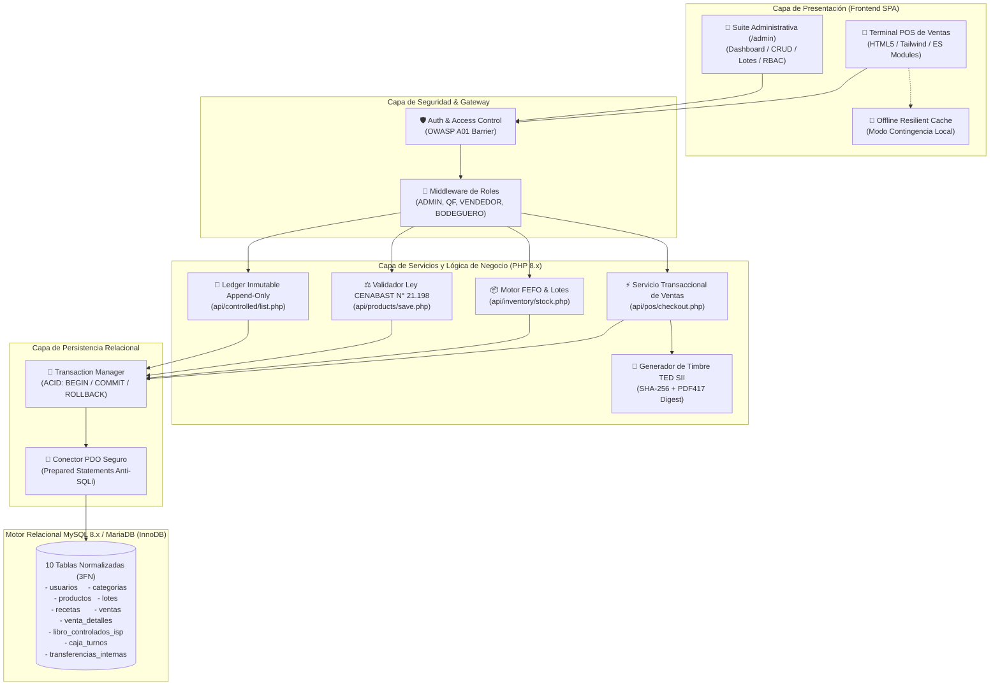

<div align="center">

# 🏥 FarmaRed Chile
### Sistema Integral de Gestión, Dispensación Asistida y Simulación de Farmacia Privada Comercial
**Arquitectura Transaccional ACID, Cumplimiento Normativo Sanitario (ISP / CENABAST) y Facturación Electrónica (SII)**

[](https://www.php.net/)
[](https://www.mysql.com/)
[](https://tailwindcss.com/)
[](https://developer.mozilla.org/es/docs/Web/JavaScript)
[](#-seguridad-y-control-de-acceso-owasp)
[](#-cumplimiento-normativo-sanitario-y-tributario-chileno)
[](LICENSE)

<br/>

[](https://proyecto-farmacia.momentumspace.cl/)
[-Acceso%20Protegido-indigo?style=for-the-badge&logo=shield&logoColor=white)](https://proyecto-farmacia.momentumspace.cl/admin)

<br/>

> **Proyecto Integrado de Ingeniería en Informática (AP-N4-C1)**  
> **Área Tecnologías de la Información y Ciberseguridad — INACAP**  
> Desarrollado por: **Sebastián Torres** ([Momentum Space](https://momentumspace.cl/)) & **Vicente Flores**  
> Docente Evaluador: **Juan José Mir Castillo**

</div>

---

## 📑 Tabla de Contenidos

1. [Visión General del Sistema](#-visión-general-del-sistema)
2. [Accesos y Demostración en Vivo](#-accesos-y-demostración-en-vivo)
3. [Arquitectura de Software y Flujo del Sistema](#-arquitectura-de-software-y-flujo-del-sistema)
4. [Diseño y Modelo de Base de Datos (DER / ERD)](#-diseño-y-modelo-de-base-de-datos-der--erd)
   - [Diagrama Entidad-Relación (Mermaid)](#diagrama-entidad-relación-mermaid)
   - [Diccionario de Datos y Especificación de Tablas](#diccionario-de-datos-y-especificación-de-tablas)
   - [Garantías Transaccionales ACID](#garantías-transaccionales-acid)
   - [Estrategia de Indexación Logística FEFO](#estrategia-de-indexación-logística-fefo)
   - [Libro Forense Inmutable Append-Only (ISP)](#libro-forense-inmutable-append-only-isp)
5. [Módulos Principales de Negocio](#-módulos-principales-de-negocio)
6. [Cumplimiento Normativo Sanitario y Tributario Chileno](#-cumplimiento-normativo-sanitario-y-tributario-chileno)
7. [Seguridad y Control de Acceso (OWASP Top 10)](#-seguridad-y-control-de-acceso-owasp)
8. [Matriz de Roles y Permisos (RBAC)](#-matriz-de-roles-y-permisos-rbac)
9. [Cuentas Maestras de Demostración](#-cuentas-maestras-de-demostración)
10. [Licencia y Créditos](#-licencia-y-créditos)

---

## 🔬 Visión General del Sistema

**FarmaRed Chile** es una solución de software de nivel industrial diseñada para resolver la encrucijada operativa de las farmacias privadas comerciales en Chile: conciliar la **alta transaccionalidad de un punto de venta minorista (POS)** con la **estricta observancia sanitaria y tributaria** exigida por el **Instituto de Salud Pública (ISP)**, el **Ministerio de Salud (MINSAL)**, la **Central de Abastecimiento (CENABAST)** y el **Servicio de Impuestos Internos (SII)**.

A diferencia de los sistemas de venta convencionales que tratan los medicamentos como artículos de retail genéricos, FarmaRed Chile incorpora motores de negocio especializados:

* **Dispensación Asistida bajo FEFO (*First Expired, First Out*):** Segregación física y lógica de stock entre *Vitrina* (sala de ventas) y *Bodega Central*, priorizando automáticamente los lotes más próximos a expirar.
* **Liquidación Dinámica de Copagos y Convenios:** Integración de coberturas de salud en tiempo real (Isapres Banmédica, Consalud, Fonasa y particulares).
* **Techo Regulatorio de la Ley CENABAST N° 21.198:** Bloqueo algorítmico contra sobreprecios especulativos en canastas fijadas por decreto supremo.
* **Trazabilidad Forense Inmutable para Estupefacientes:** Digitalización de recetas retenidas y control de saldos con cadenas criptográficas SHA-256 no repudiables.
* **Facturación Electrónica Inmediata (DTE):** Generación de Boletas Electrónicas con Timbre Electrónico del SII (TED) y código de barras térmico PDF417.

---

## 🌐 Accesos y Demostración en Vivo

El sistema se encuentra desplegado y plenamente operativo en producción en la infraestructura cloud de **[Momentum Space](https://momentumspace.cl/)**:

| Entorno de Software | Enlace Directo | Alcance y Capacidades Operativas |
| :--- | :--- | :--- |
| **🏪 Terminal de Sala de Ventas (POS)** | [proyecto-farmacia.momentumspace.cl](https://proyecto-farmacia.momentumspace.cl/) | Terminal táctil de caja, escaneo óptico EAN-13/Datamatrix, validación de RUT Módulo 11, copagos Isapre, emisión DTE con timbre TED y Libro ISP. |
| **🔐 Suite de Administración Central (/admin)** | [proyecto-farmacia.momentumspace.cl/admin](https://proyecto-farmacia.momentumspace.cl/admin) | Consola gerencial protegida con login estricto. Mantenedor CRUD de catálogo, edición de precios/CENABAST, recepción de lotes FEFO, kardex y control de usuarios RBAC. |

> [!NOTE]
> **Credenciales de Acceso para el Evaluador:**  
> **Usuario Administrador:** `admin@farmacia.cl` | **Contraseña:** `inacap2026`  
> *(El portal incluye un botón de auto-completado con un clic diseñado para agilizar la auditoría docente).*

---

## 🏗️ Arquitectura de Software y Flujo del Sistema

El software adopta el patrón de **Monolito Modular Limpio (Clean Modular Monolith)** con desacoplamiento total entre frontend y backend:



---

## 🗄️ Diseño y Modelo de Base de Datos (DER / ERD)

La base de datos relacional fue diseñada e implementada bajo estándares estrictos de **Tercera Forma Normal (3FN)**, empleando el motor de almacenamiento transaccional **InnoDB** con codificación de caracteres `utf8mb4_unicode_ci`.

### Diagrama Entidad-Relación (Mermaid)

El siguiente diagrama modela la totalidad de entidades, atributos tipados, claves primarias, claves foráneas y cardinalidades del sistema:


---

### Diccionario de Datos y Especificación de Tablas

| # | Tabla | Motor | Propósito de Negocio / Marco Normativo | Claves Foráneas (FK) & Restricciones |
| :---: | :--- | :---: | :--- | :--- |
| **1** | `usuarios` | InnoDB | Almacena el personal operativo y administrativo. Soporta control RBAC y autenticación segura con contraseñas procesadas bajo `bcrypt`. | `rut` (UNIQUE), `email` (UNIQUE). Roles restringidos a nivel de `ENUM`. |
| **2** | `categorias` | InnoDB | Clasificación terapéutica (Analgésicos, Psicotrópicos, Cardiovascular, Respiratorios, etc.). | `nombre` (UNIQUE). Integridad hacia productos. |
| **3** | `productos` | InnoDB | Catálogo maestro de fármacos. Resguarda códigos regulatorios del ISP (`codigo_isp`), EAN-13, principio activo, condición de venta y topes de la **Ley CENABAST N° 21.198**. | `categoria_id` ➔ `categorias(id)`. Restricción `ON DELETE RESTRICT`. |
| **4** | `lotes` | InnoDB | **Núcleo de la Metodología FEFO.** Segrega existencias entre sala (`stock_vitrina`) y reserva (`stock_bodega`). Fecha de caducidad indexada ascendentemente. | `producto_id` ➔ `productos(id)` `ON DELETE CASCADE`. Índice `idx_fefo` (`fecha_vencimiento` ASC). |
| **5** | `recetas` | InnoDB | Trazabilidad legal de prescripciones médicas físicas y digitales. Custodia folios, facultativo prescriptor, registro RNPI y saldo de dosis autorizadas. | `folio` (UNIQUE). Validaciones de vigencia temporal y estado de dispensación. |
| **6** | `ventas` | InnoDB | Encabezado de transacciones comerciales. Resguarda folio correlativo de Boleta DTE, descuentos Isapre/CENABAST, datos del cliente/tercero y Timbre TED del SII. | `usuario_id` ➔ `usuarios(id)`. Hash `timbre_ted_hash` (SHA-256) no repudiable. |
| **7** | `venta_detalles` | InnoDB | Detalle desagregado de cada comprobante. Cruza el producto específico con el lote de expiración exacto desde donde se rebajó el inventario. | `venta_id` ➔ `ventas(id)` `ON DELETE CASCADE`, `producto_id` ➔ `productos(id)`, `lote_id` ➔ `lotes(id)`. |
| **8** | `libro_controlados_isp` | InnoDB | **Ledger Inmutable Digital (D.S. N° 404/83 y N° 405/83).** Registra entradas y salidas de drogas fiscalizadas con visado exclusivo del Químico Farmacéutico. | Protocolo **Append-Only**. Encadenamiento criptográfico: `hash_sha256` y `hash_anterior`. |
| **9** | `caja_turnos` | InnoDB | Control financiero de mostrador. Gestiona apertura con fondo inicial y arqueo de caja ciego al término del turno laboral para prevenir fraude interno. | `usuario_id` ➔ `usuarios(id)`. Cálculo automático de desviaciones monetarias. |
| **10** | `transferencias_internas` | InnoDB | Auditoría de movimientos de reposición intralocal (traspaso atómico de unidades desde Bodega Central a Vitrina de Sala). | `producto_id` ➔ `productos(id)`, `lote_id` ➔ `lotes(id)`, `usuario_id` ➔ `usuarios(id)`. |

---

### Garantías Transaccionales ACID

En el procesamiento de compras en mostrador (`api/pos/checkout.php`), el sistema ejecuta una **transacción atómica indivisible** bajo el motor **InnoDB**:

$$\text{Transacción Exitosa} = \Delta \text{StockVitrina}_{\text{FEFO}} + \text{Insert}(\text{Venta}) + \text{Insert}(\text{Detalles}) + \text{Asiento}(\text{Libro ISP}) + \text{Deducción}(\text{Receta})$$

```php
try {
    $db->beginTransaction();

    // 1. Descontar stock del lote FEFO específico en vitrina (con bloqueo pesimista FOR UPDATE)
    $stmtStock = $db->prepare("UPDATE lotes SET stock_vitrina = stock_vitrina - ? WHERE id = ? AND stock_vitrina >= ?");
    $stmtStock->execute([$cantidad, $loteId, $cantidad]);

    // 2. Insertar encabezado de venta y timbraje TED SII
    $stmtVenta->execute([...]);
    $ventaId = $db->lastInsertId();

    // 3. Insertar detalle por cada ítem vinculado al lote
    $stmtDetalle->execute([...]);

    // 4. Si el medicamento es controlado (ISP), asentar registro en Libro Oficial encadenando hash
    if ($esControlado) {
        $stmtIsp->execute([...]);
    }

    // 5. Consolidación atómica de la transacción
    $db->commit();
} catch (Exception $e) {
    // Si cualquiera de los 4 pasos falla, se revierte íntegramente la operación
    $db->rollBack();
    jsonResponse(['success' => false, 'error' => 'Transacción cancelada: ' . $e->getMessage()], 500);
}
```

> [!IMPORTANT]
> **Consistencia Inquebrantable:** Si el servidor experimenta una pérdida de suministro eléctrico o desconexión en medio del timbraje, la operación se revierte por completo (`rollBack()`), impidiendo discrepancias donde el dinero quede recaudado pero los estupefacientes no figuren en el balance del ISP.

---

### Estrategia de Indexación Logística FEFO

Para cumplir con la **Norma Técnica N° 147 de Buenas Prácticas de Almacenamiento (BPA)** del Ministerio de Salud y eliminar pérdidas económicas por expiración en estantería, la tabla `lotes` implementa el índice optimizado:

```sql
INDEX `idx_fefo` (`fecha_vencimiento` ASC)
```

Cuando un cajero digita un medicamento en el POS, el motor de base de datos ejecuta una consulta con ordenamiento ascendente por fecha de caducidad filtrando por existencias disponibles en sala:

```sql
SELECT id, numero_lote, fecha_vencimiento, stock_vitrina 
FROM lotes 
WHERE producto_id = :producto_id AND stock_vitrina > 0 
ORDER BY fecha_vencimiento ASC 
LIMIT 1;
```

Esto garantiza un tiempo de ejecución de orden $O(\log N)$, despachando con prioridad matemática el lote más antiguo sin depender de la memoria o criterio del personal de turno.

---

### Libro Forense Inmutable Append-Only (ISP)

La tabla `libro_controlados_isp` digitaliza con garantías jurídicas los Libros Oficiales de Control de Psicotrópicos y Estupefacientes exigidos por los Decretos Supremos N° 404/83 y N° 405/83. 

Para otorgar valor probatorio ante fiscalizaciones del Instituto de Salud Pública (ISP), se adoptó una arquitectura **Append-Only** inspirada en la estructura de bloques criptográficos (*Blockchain / Merkle Trees*):

1. **Inmutabilidad en Persistencia:** A nivel de privilegios de base de datos se revoca formalmente cualquier permiso de actualización (`UPDATE`) o borrado (`DELETE`).
2. **Encadenamiento Criptográfico de Asientos:** Cada nuevo asiento calcula su firma mediante un hash **SHA-256** que incorpora el hash del asiento previo:
   $$\text{Hash}_n = \text{SHA256}(\text{Fecha} \parallel \text{ProductoID} \parallel \text{LoteID} \parallel \text{Saldo} \parallel \text{RecetaFolio} \parallel \text{Hash}_{n-1})$$
3. **Detección Forense de Adulteraciones:** Cualquier intento de manipulación retrospectiva de los saldos fractura de manera irrevocable la cadena criptográfica, permitiendo auditar inmediatamente fraudes internos o desvíos ilícitos de psicofármacos.

---

## 💼 Módulos Principales de Negocio

### 1. Terminal Punto de Venta (POS) Táctil & Ergonómico
* **Lectura Óptica `[F2]`:** Soporte nativo para escáneres de códigos de barras EAN-13 y códigos bidimensionales Datamatrix.
* **Liquidación de Aseguradoras:** Validación automática de previsión mediante algoritmo Módulo 11 para el RUT chileno, con deducción automática de bonificaciones de Isapres (Banmédica 60%, Consalud 50%, Fonasa 40%, Particular).
* **Cumplimiento Ley CENABAST N° 21.198:** Detección de fármacos con precio regulado y bloqueo automático contra márgenes que superen el decreto tarifario del Estado.
* **Comprobante Tributario Electrónico (DTE):** Emisión instantánea de Boleta Electrónica con Timbre Electrónico del SII (TED), formato térmico estándar de 80mm e impresión directa.

### 2. Gestión Logística Dual (Vitrina vs. Bodega Central)
* **Separación de Ubicaciones Físicas:** Control diferenciado de inventario en mostrador (para venta inmediata) y almacén de reserva.
* **Semáforos de Vencimiento:** Alertas cromáticas en tiempo real:
  - 🔴 **Crítico (< 30 días):** Alerta prioritaria de rotación inmediata o merma.
  - 🟡 **Alerta (30 - 90 días):** Notificación de traspaso preferencial a vitrina.
  - 🟢 **Óptimo (> 90 días):** Partida en condiciones normales de conservación.
* **Traspasos Internos Atómicos:** Módulo de transferencia con actualización síncrona de saldos entre bodeguero y cajero.

### 3. Suite Administrativa Centralizada (`/admin`)
* **Consola Gerencial Segregada:** Módulo autónomo protegido bajo la ruta `/admin` que aísla las funciones estratégicas del flujo de ventas.
* **Mantenedor CRUD de Catálogo:** Registro y modificación de medicamentos con parámetros regulatorios (código ISP oficial, código de barra, condición de venta y techo CENABAST).
* **Recepción de Partidas de Proveedores:** Ingreso formal de remesas de laboratorio con serialización de lotes y asignación inmediata de existencias.
* **Kardex Transaccional en Vivo:** Monitoreo en tiempo real de cada boleta emitida, montos de copago y timbre fiscal.
* **Administración de Personal (RBAC):** Creación y suspensión de credenciales con hashing seguro `bcrypt`.

---

## ⚖️ Cumplimiento Normativo Sanitario y Tributario Chileno

| Organismo / Ley | Cuerpo Legal | Mecanismo de Implementación en FarmaRed Chile |
| :--- | :--- | :--- |
| **CENABAST / MINSAL** | **Ley N° 21.198** (Ley CENABAST) | Campo `precio_cenabast_max` en base de datos. La capa de dominio impide guardar o cobrar precios que sobrepasen el techo legal decretado. |
| **ISP (Salud Pública)** | **D.S. N° 404/83** (Estupefacientes)<br/>**D.S. N° 405/83** (Psicotrópicos) | Módulo del **Libro Oficial Digital de Controlados** con firmas criptográficas encadenadas SHA-256 y visado del Químico Farmacéutico. |
| **MINSAL (Sanidad)** | **D.S. N° 466/84** (Reglamento de Farmacias)<br/>**Norma Técnica N° 147** (BPA) | Metodología de rotación obligatoria **FEFO** indexada y segregación estricta de stock entre vitrina y bodega central. |
| **SII (Tributario)** | **Resolución Exenta N° 19/2008** (DTE SII) | Generación de Timbre Electrónico del SII (TED), hash SHA-256 del comprobante y código bidimensional PDF417 térmico. |
| **Protección Datos** | **Ley N° 19.628** y **Ley N° 20.584** | Cifrado de diagnósticos médicos y prescripciones en reposo, enmascaramiento de datos y control de accesos granular. |

---

## 🔒 Seguridad y Control de Acceso (OWASP)

FarmaRed Chile fue concebido bajo el principio de **Seguridad por Diseño (Security by Design)**, mitigando los vectores de riesgo más críticos del estándar internacional **OWASP Top 10:2021**:

```
[Cliente Web (POS)]              [Intento de Escalación]              [Suite /admin]
        │                                  │                                 │
        ├── Switch a "Administrador" ────> ❌ Modal de Contraseña             │
        │                                  │  (Exige clave inacap2026)        │
        │                                  │                                 │
        └── Navegación a /admin ─────────> 🛡️ Login Barrier Bloqueante ─────> ✅ Acceso Exclusivo
                                              (Token de Sesión Efímero)
```

1. **Mitigación de OWASP A01 (Broken Access Control):**  
   - La suite gerencial reside en la ruta aislada `/admin`, blindada con una barrera de login bloqueante que impide cualquier renderizado previo a la autenticación.
   - En el Punto de Venta (`/`), cualquier intento de conmutar hacia el perfil de *Administrador* despliega de inmediato un modal de seguridad bloqueante que exige la contraseña maestra (`inacap2026`), impidiendo la escalación vertical de privilegios por parte de cajeros u operadores de turno.
2. **Mitigación de OWASP A03 (Injection):**  
   - El 100% de las consultas a la base de datos se ejecutan a través de **PDO con Sentencias Preparadas (Prepared Statements)** y enlace tipado de parámetros, neutralizando cualquier intento de inyección SQL en búsquedas de fármacos, login o checkout.
3. **Mitigación de OWASP A07 (Identification and Authentication Failures):**  
   - Las contraseñas de los usuarios se almacenan en la tabla `usuarios` utilizando el algoritmo estándar **`bcrypt`** con costo computacional adaptable.
4. **Protección del Servidor Web (Apache `.htaccess`):**  
   - Denegación explícita de lectura directa a archivos de configuración (`.env`, `.sql`), activación de compresión gzip (`mod_deflate`) y cabeceras de protección HTTP: `X-Frame-Options: SAMEORIGIN` y `X-Content-Type-Options: nosniff`.

---

## 👥 Matriz de Roles y Permisos (RBAC)

| Módulo / Atribución Operacional | 👑 Administrador General | 🔬 Químico Farmacéutico (DT) | 🛒 Vendedor / Cajero | 📦 Operador de Bodega |
| :--- | :---: | :---: | :---: | :---: |
| **Operación de Caja y Terminal POS** | ✅ Total | ❌ Restringido | ✅ Total | ❌ Denegado |
| **Emisión de Boleta Electrónica DTE** | ✅ Total | ❌ Restringido | ✅ Total | ❌ Denegado |
| **Apertura y Arqueo Ciego de Turno** | ✅ Auditoría | ❌ Denegado | ✅ Operativo | ❌ Denegado |
| **Visado de Recetas Retenidas** | ❌ Sanitario | ✅ Exclusivo (DT) | ❌ Denegado | ❌ Denegado |
| **Libro Oficial de Controlados ISP** | 👁️ Solo Lectura | ✅ Firma Digital | ❌ Denegado | ❌ Denegado |
| **Transferencias Bodega ➔ Vitrina** | ✅ Total | 👁️ Lectura | 📥 Solicitud | ✅ Ejecución |
| **Recepción de Partidas y Lotes FEFO** | ✅ Total | ✅ Calidad | ❌ Denegado | ✅ Almacén |
| **CRUD Catálogo y Techo CENABAST** | ✅ Exclusivo | 👁️ Solo Lectura | ❌ Denegado | ❌ Denegado |
| **Gestión de Personal y Cuentas** | ✅ Exclusivo | ❌ Denegado | ❌ Denegado | ❌ Denegado |

---

## 🔑 Cuentas Maestras de Demostración

Para auditoría docente y experimentación académica, la base de datos cuenta con cuatro cuentas preconfiguradas:

| Rol / Perfil Operativo | Correo Electrónico | Contraseña Oficial | Entorno Recomendado |
| :--- | :--- | :--- | :--- |
| **Administrador General** | `admin@farmacia.cl` | `inacap2026` | [proyecto-farmacia.momentumspace.cl/admin](https://proyecto-farmacia.momentumspace.cl/admin) |
| **Químico Farmacéutico (DT)** | `qf@farmacia.cl` | `inacap2026` | [proyecto-farmacia.momentumspace.cl/?tab=isp&role=QF](https://proyecto-farmacia.momentumspace.cl/?tab=isp&role=QF) |
| **Cajero / Vendedor** | `cajero@farmacia.cl` | `inacap2026` | [proyecto-farmacia.momentumspace.cl/?tab=pos&role=CAJERO](https://proyecto-farmacia.momentumspace.cl/?tab=pos&role=CAJERO) |
| **Operador de Bodega** | `bodega@farmacia.cl` | `inacap2026` | [proyecto-farmacia.momentumspace.cl/?tab=inventory&role=BODEGUERO](https://proyecto-farmacia.momentumspace.cl/?tab=inventory&role=BODEGUERO) |

---

## 📄 Licencia y Créditos

Este proyecto se distribuye bajo la **Licencia MIT**. Consulta el archivo [`LICENSE`](LICENSE) para más detalles.

```
MIT License
Copyright (c) 2026 Sebastián Torres (Momentum Space) & Vicente Flores
```

Desarrollado con dedicación y excelencia en Santiago de Chile 🇨🇱 por:
* **Sebastián Torres** — Fundador & Tech Lead en **[Momentum Space](https://momentumspace.cl/)**
* **Vicente Flores** — Co-autor & Desarrollador de Software

**Asignatura:** Proyecto Integrado de Software (AP-N4-C1)  
**Docente Evaluador:** **Juan José Mir Castillo**  
**Institución:** Universidad Tecnológica de Chile / Instituto Profesional **INACAP** — Sede Santiago Centro.
