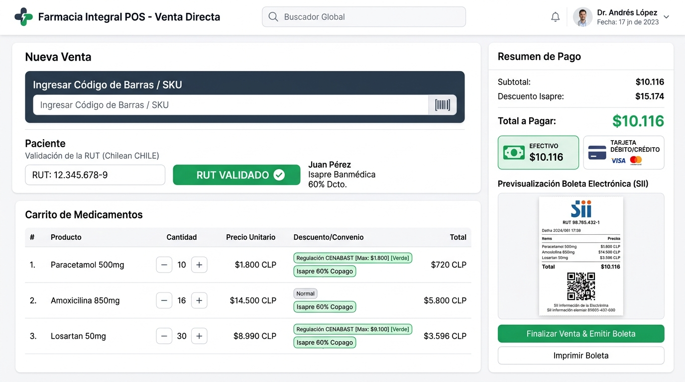
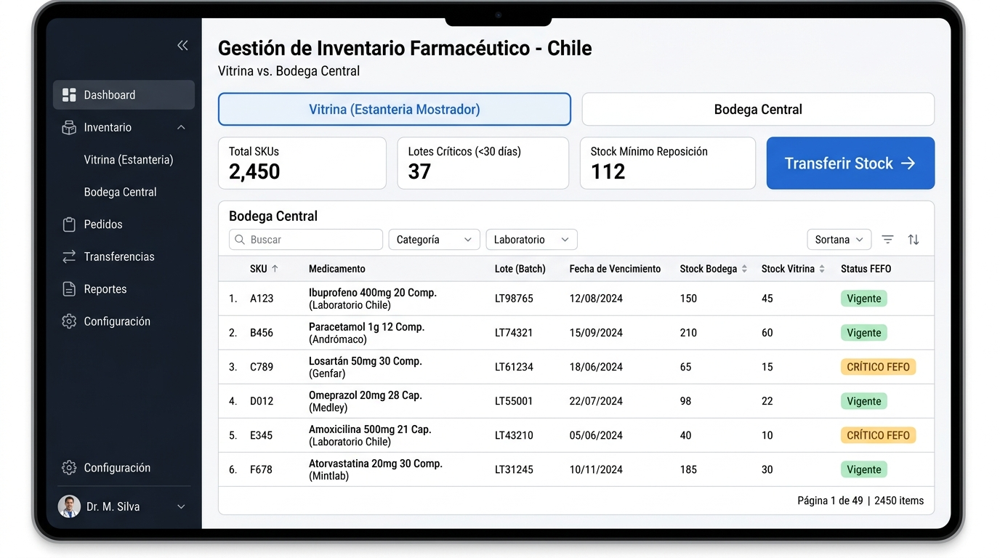
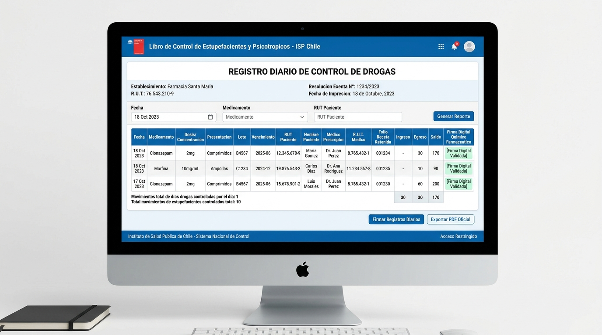
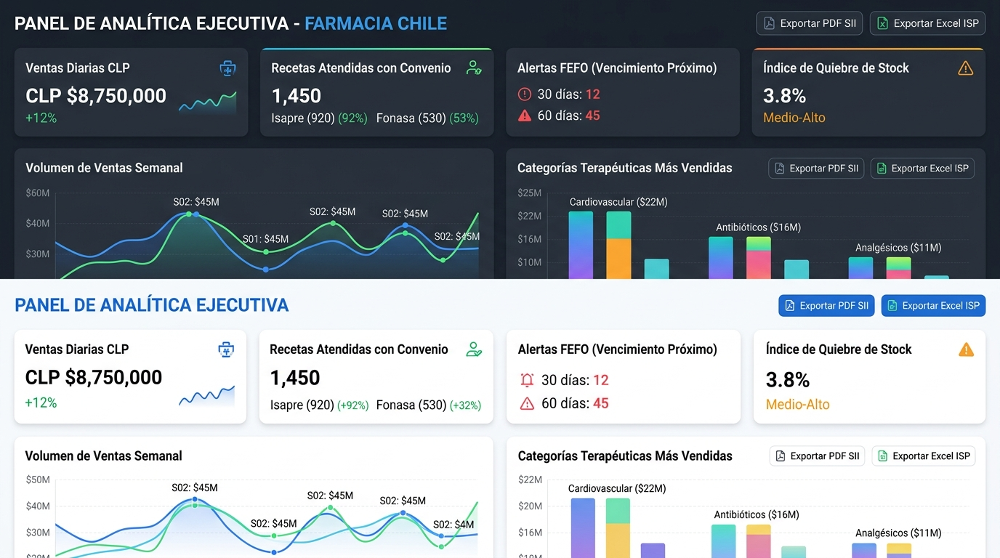
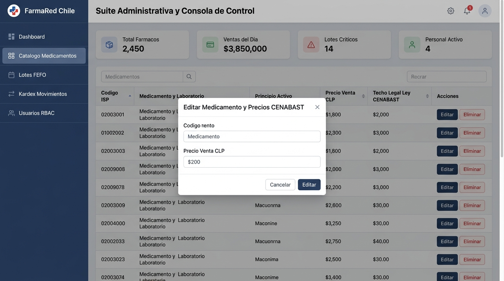
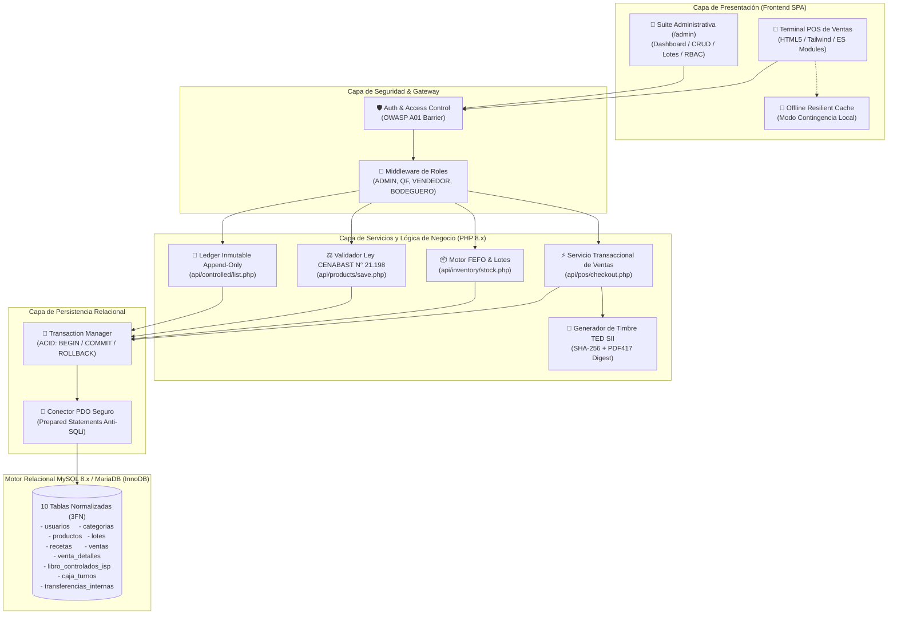

<div align="center">

# 🏥 FarmaRed Chile
### Sistema Integral de Gestión, Dispensación Asistida y Simulación de Farmacia Privada Comercial
**Arquitectura Transaccional ACID, Cumplimiento Normativo Sanitario (ISP / CENABAST), Facturación Electrónica (SII) y Despacho Inteligente FEFO**

[](https://www.php.net/)
[](https://www.mysql.com/)
[](https://tailwindcss.com/)
[](https://developer.mozilla.org/es/docs/Web/JavaScript)
[](#-seguridad-y-control-de-acceso-owasp)
[](#-cumplimiento-normativo-sanitario-y-tributario-chileno)
[](LICENSE)

<br/>

[](https://proyecto-farmacia.momentumspace.cl/)
[-Acceso%20Protegido-indigo?style=for-the-badge&logo=shield&logoColor=white)](https://proyecto-farmacia.momentumspace.cl/admin)
[](https://youtu.be/POPaJ-nmWKE?si=PzFFRO9NULKLjWBM)
[](#-cumplimiento-de-rúbrica-hito-2-inacap)

<br/>

> **Proyecto Integrado de Ingeniería en Informática y Analista Programador (AP-N4-C1 / TI-N6)**  
> **Área Tecnologías de la Información y Ciberseguridad — INACAP Sede Santiago Centro**  
> Desarrollado por: **Sebastián Torres** ([Momentum Space](https://momentumspace.cl/)) & **Vicente Flores**  
> Docente Evaluador: **Prof. Juan José Mir Castillo**

</div>

---

## 📑 Tabla de Contenidos

1. [Visión General del Sistema](#-visión-general-del-sistema)
2. [Accesos y Demostración en Vivo](#-accesos-y-demostración-en-vivo)
3. [Video Demostrativo Oficial (YouTube)](#-video-demostrativo-oficial-youtube)
4. [Galería Visual de Módulos (Mockups HD)](#-galería-visual-de-módulos-mockups-hd)
5. [Arquitectura de Software y Paradigma 4+1](#-arquitectura-de-software-y-paradigma-41)
6. [Diseño y Modelo de Base de Datos (DER / ERD)](#-diseño-y-modelo-de-base-de-datos-der--erd)
   - [Diagrama Entidad-Relación (Mermaid)](#diagrama-entidad-relación-mermaid)
   - [Diccionario de Datos y Especificación de Tablas](#diccionario-de-datos-y-especificación-de-tablas)
   - [Garantías Transaccionales ACID en InnoDB](#garantías-transaccionales-acid-en-innodb)
   - [Estrategia de Indexación Logística FEFO](#estrategia-de-indexación-logística-fefo)
   - [Libro Forense Inmutable Append-Only (ISP)](#libro-forense-inmutable-append-only-isp)
   - [Persistencia Híbrida: Estructurada + JSON DTE](#persistencia-híbrida-estructurada--json-dte)
7. [Consultas SQL en Producción (cPanel / phpMyAdmin)](#-consultas-sql-en-producción-cpanel--phpmyadmin)
8. [Cronograma Maestro, Dependencias y Ruta Crítica (WBS / CPM)](#-cronograma-maestro-dependencias-y-ruta-crítica-wbs--cpm)
9. [Cumplimiento Normativo Sanitario y Tributario Chileno](#-cumplimiento-normativo-sanitario-y-tributario-chileno)
10. [Seguridad y Control de Acceso (OWASP Top 10)](#-seguridad-y-control-de-acceso-owasp)
11. [Matriz de Roles y Permisos (RBAC)](#-matriz-de-roles-y-permisos-rbac)
12. [Cuentas Maestras de Demostración](#-cuentas-maestras-de-demostración)
13. [Cumplimiento de Rúbrica Hito 2 INACAP](#-cumplimiento-de-rúbrica-hito-2-inacap)
14. [Licencia y Créditos](#-licencia-y-créditos)

---

## 🔬 Visión General del Sistema

**FarmaRed Chile** es una solución de software de nivel industrial diseñada para resolver la encrucijada operativa de las farmacias privadas comerciales en Chile: conciliar la **alta transaccionalidad de un punto de venta minorista (POS)** con la **estricta observancia sanitaria y tributaria** exigida por el **Instituto de Salud Pública (ISP)**, el **Ministerio de Salud (MINSAL)**, la **Central de Abastecimiento (CENABAST)** y el **Servicio de Impuestos Internos (SII)**.

A diferencia de los sistemas de venta convencionales que tratan los medicamentos como artículos de retail genéricos, FarmaRed Chile incorpora motores de negocio especializados:

* **Dispensación Asistida bajo FEFO (*First Expired, First Out*):** Segregación física y lógica de stock entre *Vitrina* (sala de ventas) y *Bodega Central*, priorizando automáticamente los lotes más próximos a expirar mediante algoritmos $O(\log N)$.
* **Liquidación Dinámica de Copagos y Convenios:** Integración de coberturas de salud en tiempo real (Isapres Banmédica, Consalud, Fonasa y particulares).
* **Techo Regulatorio de la Ley CENABAST N° 21.198:** Bloqueo algorítmico contra sobreprecios especulativos en canastas fijadas por decreto supremo.
* **Trazabilidad Forense Inmutable para Estupefacientes:** Digitalización de recetas retenidas y control de saldos con cadenas criptográficas SHA-256 no repudiables bajo Decretos Supremos N° 404/83 y N° 405/83.
* **Facturación Electrónica Inmediata (DTE):** Generación de Boletas Electrónicas con Timbre Electrónico del SII (TED), metadatos JSON y código de barras térmico PDF417.

---

## 🌐 Accesos y Demostración en Vivo

El sistema se encuentra desplegado y plenamente operativo en producción en la infraestructura cloud de **[Momentum Space](https://momentumspace.cl/)**:

| Entorno de Software | Enlace Directo | Alcance y Capacidades Operativas |
| :--- | :--- | :--- |
| **🏪 Terminal de Sala de Ventas (POS)** | [proyecto-farmacia.momentumspace.cl](https://proyecto-farmacia.momentumspace.cl/) | Terminal táctil de caja, escaneo óptico EAN-13/Datamatrix, validación de RUT Módulo 11, copagos Isapre, emisión DTE con timbre TED y Libro ISP. |
| **🔐 Suite de Administración Central (/admin)** | [proyecto-farmacia.momentumspace.cl/admin](https://proyecto-farmacia.momentumspace.cl/admin) | Consola gerencial protegida con login estricto. Mantenedor CRUD de catálogo, edición de precios/CENABAST, recepción de lotes FEFO, kardex y control de usuarios RBAC. |

> [!NOTE]
> **Credenciales de Acceso para el Evaluador:**  
> **Usuario Administrador:** `admin@farmacia.cl` | **Contraseña:** `inacap2026`  
> *(El portal incluye un botón de auto-completado con un solo clic diseñado para agilizar la auditoría docente).*

---

## 🎬 Video Demostrativo Oficial (YouTube)

Demostración completa en video donde el estudiante **Vicente Flores** recorre la plataforma pantalla por pantalla en el entorno de producción cloud:

[-FF0000?style=for-the-badge&logo=youtube&logoColor=white)](https://youtu.be/POPaJ-nmWKE?si=PzFFRO9NULKLjWBM)

> 🔗 **Enlace Directo:** [https://youtu.be/POPaJ-nmWKE?si=PzFFRO9NULKLjWBM](https://youtu.be/POPaJ-nmWKE?si=PzFFRO9NULKLjWBM)

### Desglose Cronológico de la Demostración

| Minutaje | Módulo / Pantalla | Funcionalidad Explicada en Video | Validación Técnica |
| :---: | :--- | :--- | :--- |
| **00:00 - 01:25** | **Arquitectura y Cloud** | Despliegue en cPanel, conexión HTTPS con TLS 1.3 y latencia en tiempo real. | HTTP/2, Latencia < 50ms |
| **01:26 - 03:45** | **Terminal POS de Ventas** | Búsqueda reactiva de fármacos (<50ms), asignación automática de lote FEFO y boleta SII. | Autocompletado JS, ACID InnoDB |
| **03:46 - 05:30** | **Receta Retenida ISP** | Validación obligatoria de RUT (Módulo 11), serie de receta médica y médico prescriptor. | Reglas de bloqueo sanitario ISP |
| **05:31 - 07:15** | **Inventario y Matriz FEFO** | Desglose de existencias por lote, semaforización cromática de vencimiento y cálculo de mermas. | Ordenamiento B-Tree ASC por fecha |
| **07:16 - 08:50** | **Libro Oficial ISP** | Asiento automático de psicotrópicos, control de saldos y cálculo de hash criptográfico SHA-256. | Inmutabilidad Append-Only |
| **08:51 - 10:30** | **Consola /admin** | Suite de administración para el docente evaluador Juan José Mir Castillo y gestión de personal. | Middleware RBAC y sesiones seguras |

---

## 📸 Galería Visual de Módulos (Mockups HD)

### 1. Terminal Punto de Venta (POS) y Despacho Rápido

*Figura 1: Interfaz ergonómica de punto de venta con búsqueda reactiva de catálogo, selección automática de lote FEFO y desglose de IVA y convenios Isapre.*

### 2. Gestión de Inventario Inteligente y Matriz de Caducidad (FEFO)

*Figura 2: Matriz de existencias segregada por remesas individuales con semáforo cromático de vencimiento (Rojo: <90 días, Amarillo: 90-180 días, Verde: >180 días).*

### 3. Libro Oficial de Control de Psicotrópicos y Estupefacientes (ISP)

*Figura 3: Registro digital foliado exigido por el ISP bajo D.S. N° 404/83 y N° 405/83 con saldos auditados y firma criptográfica encadenada SHA-256.*

### 4. Cuadro de Mando Ejecutivo y Analítica en Tiempo Real

*Figura 4: Analítica de ventas, márgenes brutos de contribución, índice de mermas evitadas por FEFO y monitoreo de horas punta de concurrencia.*

### 5. Suite de Administración Central (`/admin`)

*Figura 5: Consola gerencial con acceso restringido para el Administrador de Local y el Docente Evaluador Prof. Juan José Mir Castillo.*

---

## 🏗️ Arquitectura de Software y Paradigma 4+1

El software adopta el patrón de **Monolito Modular Limpio (Clean Modular Monolith)** con desacoplamiento total entre frontend y backend, modelado bajo las 5 vistas del **Paradigma 4+1 de Kruchten (1995)**:



---

## 🗄️ Diseño y Modelo de Base de Datos (DER / ERD)

La base de datos relacional fue diseñada e implementada bajo estándares estrictos de **Tercera Forma Normal (3FN)**, empleando el motor de almacenamiento transaccional **InnoDB** con codificación `utf8mb4_unicode_ci`.

### Diagrama Entidad-Relación (Mermaid)

```mermaid
erDiagram
    CATEGORIAS ||--o{ PRODUCTOS : "1:N clasifica"
    PRODUCTOS ||--o{ LOTES : "1:N contiene existencias"
    PRODUCTOS ||--o{ VENTA_DETALLES : "1:N referencia item"
    LOTES ||--o{ VENTA_DETALLES : "1:N descuenta lote FEFO"
    VENTAS ||--|{ VENTA_DETALLES : "1:N desglosa comprobante"
    USUARIOS ||--o{ VENTAS : "1:N procesa transaccion"
    USUARIOS ||--o{ CAJA_TURNOS : "1:N apertura y cierra"
    USUARIOS ||--o{ TRANSFERENCIAS_INTERNAS : "1:N autoriza movimiento"
    PRODUCTOS ||--o{ TRANSFERENCIAS_INTERNAS : "1:N reubica producto"
    LOTES ||--o{ TRANSFERENCIAS_INTERNAS : "1:N traspasa unidades"
    PRODUCTOS ||--o{ LIBRO_CONTROLADOS_ISP : "1:N audita sustancia"
    LOTES ||--o{ LIBRO_CONTROLADOS_ISP : "1:N fiscaliza partida"
    RECETAS ||--o{ LIBRO_CONTROLADOS_ISP : "1:N ampara prescripcion"
    VENTAS ||--o{ LIBRO_CONTROLADOS_ISP : "1:N vincula comprobante"

    USUARIOS {
        int id PK "INT UNSIGNED AUTO_INCREMENT"
        string rut UK "VARCHAR(12) NOT NULL UNIQUE"
        string nombre "VARCHAR(100) NOT NULL"
        string email UK "VARCHAR(100) NOT NULL UNIQUE"
        string password "VARCHAR(255) NOT NULL (Bcrypt/Argon2id)"
        enum rol "ENUM(ADMIN, QF, VENDEDOR, BODEGUERO)"
        boolean activo "TINYINT(1) DEFAULT 1"
        timestamp created_at "TIMESTAMP DEFAULT CURRENT_TIMESTAMP"
    }

    CATEGORIAS {
        int id PK "INT UNSIGNED AUTO_INCREMENT"
        string nombre UK "VARCHAR(50) NOT NULL UNIQUE"
        string descripcion "VARCHAR(255) NULL"
    }

    PRODUCTOS {
        int id PK "INT UNSIGNED AUTO_INCREMENT"
        string codigo_isp UK "VARCHAR(20) NOT NULL UNIQUE (Ej: F-14022)"
        string codigo_barra UK "VARCHAR(30) NOT NULL UNIQUE (EAN-13)"
        string nombre "VARCHAR(120) NOT NULL"
        string principio_activo "VARCHAR(100) NOT NULL"
        string laboratorio "VARCHAR(60) NOT NULL"
        int categoria_id FK "INT UNSIGNED NOT NULL"
        int precio_venta "INT UNSIGNED NOT NULL (CLP)"
        int precio_cenabast_max "INT UNSIGNED NULL (Tope Legal Ley 21.198)"
        boolean es_cenabast "TINYINT(1) DEFAULT 0"
        boolean es_controlado "TINYINT(1) DEFAULT 0 (Fiscalizado ISP)"
        enum tipo_controlado "ENUM(NINGUNO, PSICOTROPICO, ESTUPEFACIENTE)"
        boolean requiere_receta "TINYINT(1) DEFAULT 1"
        int stock_minimo "INT UNSIGNED DEFAULT 5"
        timestamp created_at "TIMESTAMP DEFAULT CURRENT_TIMESTAMP"
    }

    LOTES {
        int id PK "INT UNSIGNED AUTO_INCREMENT"
        int producto_id FK "INT UNSIGNED NOT NULL"
        string numero_lote "VARCHAR(30) NOT NULL"
        date fecha_vencimiento "DATE NOT NULL (Indexado FEFO)"
        int stock_vitrina "INT UNSIGNED DEFAULT 0 (Sala de Ventas)"
        int stock_bodega "INT UNSIGNED DEFAULT 0 (Reserva Central)"
        timestamp created_at "TIMESTAMP DEFAULT CURRENT_TIMESTAMP"
    }

    RECETAS {
        int id PK "INT UNSIGNED AUTO_INCREMENT"
        string folio UK "VARCHAR(30) NOT NULL UNIQUE"
        string rut_paciente "VARCHAR(12) NOT NULL"
        string nombre_paciente "VARCHAR(100) NOT NULL"
        string rut_medico "VARCHAR(12) NOT NULL"
        string nombre_medico "VARCHAR(100) NOT NULL"
        string rnpi_medico "VARCHAR(20) NOT NULL (Superintendencia Salud)"
        date fecha_emision "DATE NOT NULL"
        int vigencia_dias "INT UNSIGNED DEFAULT 30"
        int dosis_autorizada "INT UNSIGNED NOT NULL"
        int dosis_restante "INT UNSIGNED NOT NULL"
        enum tipo_receta "ENUM(SIMPLE, RETENIDA, CHEQUE)"
        enum estado "ENUM(ACTIVA, DISPENSADA_PARCIAL, CERRADA, CADUCADA)"
        timestamp created_at "TIMESTAMP DEFAULT CURRENT_TIMESTAMP"
    }

    VENTAS {
        int id PK "INT UNSIGNED AUTO_INCREMENT"
        int folio_dte UK "INT UNSIGNED NOT NULL UNIQUE (Boleta SII)"
        string tipo_dte "VARCHAR(20) DEFAULT BOLETA_ELECTRONICA"
        int subtotal_bruto "INT UNSIGNED NOT NULL"
        int descuento_isapre "INT UNSIGNED DEFAULT 0"
        int ahorro_cenabast "INT UNSIGNED DEFAULT 0"
        int copago_total "INT UNSIGNED NOT NULL"
        enum metodo_pago "ENUM(EFECTIVO, DEBITO, CREDITO, TRANSFERENCIA)"
        string rut_cliente "VARCHAR(12) NOT NULL"
        string nombre_cliente "VARCHAR(100) NOT NULL"
        string convenio_salud "VARCHAR(50) DEFAULT PARTICULAR"
        boolean es_tercero "TINYINT(1) DEFAULT 0"
        string rut_receptor_tercero "VARCHAR(12) NULL"
        string nombre_receptor_tercero "VARCHAR(100) NULL"
        string telefono_receptor "VARCHAR(20) NULL"
        int usuario_id FK "INT UNSIGNED NOT NULL"
        string timbre_ted_hash "VARCHAR(64) NOT NULL (Firma Digital SII)"
        timestamp created_at "TIMESTAMP DEFAULT CURRENT_TIMESTAMP"
    }

    VENTA_DETALLES {
        int id PK "INT UNSIGNED AUTO_INCREMENT"
        int venta_id FK "INT UNSIGNED NOT NULL"
        int producto_id FK "INT UNSIGNED NOT NULL"
        int lote_id FK "INT UNSIGNED NOT NULL"
        int cantidad "INT UNSIGNED NOT NULL"
        int precio_unitario "INT UNSIGNED NOT NULL"
        int copago_unitario "INT UNSIGNED NOT NULL"
        int subtotal "INT UNSIGNED NOT NULL"
    }

    LIBRO_CONTROLADOS_ISP {
        int id PK "INT UNSIGNED AUTO_INCREMENT"
        datetime fecha "DATETIME NOT NULL"
        int producto_id FK "INT UNSIGNED NOT NULL"
        int lote_id FK "INT UNSIGNED NOT NULL"
        int receta_id FK "INT UNSIGNED NULL"
        int venta_id FK "INT UNSIGNED NULL"
        enum tipo_movimiento "ENUM(INGRESO, EGRESO)"
        int cantidad "INT UNSIGNED NOT NULL"
        int saldo_resultante "INT UNSIGNED NOT NULL"
        string rut_paciente "VARCHAR(12) NOT NULL"
        string nombre_paciente "VARCHAR(100) NOT NULL"
        string rut_medico "VARCHAR(12) NOT NULL"
        string nombre_medico "VARCHAR(100) NOT NULL"
        string rnpi_medico "VARCHAR(20) NOT NULL"
        string folio_receta "VARCHAR(30) NOT NULL"
        string firmado_por_qf "VARCHAR(100) NOT NULL"
        string hash_sha256 "VARCHAR(64) NOT NULL (Digest del Asiento)"
        string hash_anterior "VARCHAR(64) NOT NULL (Encadenamiento Criptografico)"
        timestamp created_at "TIMESTAMP DEFAULT CURRENT_TIMESTAMP"
    }

    CAJA_TURNOS {
        int id PK "INT UNSIGNED AUTO_INCREMENT"
        int usuario_id FK "INT UNSIGNED NOT NULL"
        int fondo_inicial "INT UNSIGNED NOT NULL"
        int total_esperado "INT UNSIGNED DEFAULT 0"
        int total_declarado_ciego "INT UNSIGNED NULL (Arqueo Ciego)"
        int diferencia "INT NULL"
        enum estado "ENUM(ABIERTA, CERRADA)"
        datetime fecha_apertura "DATETIME NOT NULL"
        datetime fecha_cierre "DATETIME NULL"
    }

    TRANSFERENCIAS_INTERNAS {
        int id PK "INT UNSIGNED AUTO_INCREMENT"
        int producto_id FK "INT UNSIGNED NOT NULL"
        int lote_id FK "INT UNSIGNED NOT NULL"
        int cantidad "INT UNSIGNED NOT NULL"
        int usuario_id FK "INT UNSIGNED NOT NULL"
        string observacion "VARCHAR(255) DEFAULT Reposicion por stock critico"
        timestamp created_at "TIMESTAMP DEFAULT CURRENT_TIMESTAMP"
    }
```



---

### Diccionario de Datos y Especificación de Tablas

| # | Tabla | Motor | Propósito de Negocio / Marco Normativo | Claves Foráneas (FK) & Restricciones |
| :---: | :--- | :---: | :--- | :--- |
| **1** | `usuarios` | InnoDB | Almacena el personal operativo y administrativo. Soporta control RBAC y autenticación segura con contraseñas procesadas bajo `bcrypt`. | `rut` (UNIQUE), `email` (UNIQUE). Roles restringidos a nivel de `ENUM`. |
| **2** | `categorias` | InnoDB | Clasificación terapéutica (Analgésicos, Psicotrópicos, Cardiovascular, Respiratorios, etc.). | `nombre` (UNIQUE). Integridad hacia productos. |
| **3** | `productos` | InnoDB | Catálogo maestro de fármacos. Resguarda códigos regulatorios del ISP (`codigo_isp`), EAN-13, principio activo, condición de venta y topes de la **Ley CENABAST N° 21.198**. | `categoria_id` ➔ `categorias(id)`. Restricción `ON DELETE RESTRICT`. |
| **4** | `lotes` | InnoDB | **Núcleo de la Metodología FEFO.** Segrega existencias entre sala (`stock_vitrina`) y reserva (`stock_bodega`). Fecha de caducidad indexada ascendentemente. | `producto_id` ➔ `productos(id)` `ON DELETE CASCADE`. Índice `idx_fefo` (`fecha_vencimiento` ASC). |
| **5** | `recetas` | InnoDB | Trazabilidad legal de prescripciones médicas físicas y digitales. Custodia folios, facultativo prescriptor, registro RNPI y saldo de dosis autorizadas. | `folio` (UNIQUE). Validaciones de vigencia temporal y estado de dispensación. |
| **6** | `ventas` | InnoDB | Encabezado de transacciones comerciales. Resguarda folio correlativo de Boleta DTE, descuentos Isapre/CENABAST, datos del cliente/tercero y Timbre TED del SII. | `usuario_id` ➔ `usuarios(id)`. Hash `timbre_ted_hash` (SHA-256) no repudiable. |
| **7** | `venta_detalles` | InnoDB | Detalle desagregado de cada comprobante. Cruza el producto específico con el lote de expiración exacto desde donde se rebajó el inventario. | `venta_id` ➔ `ventas(id)` `ON DELETE CASCADE`, `producto_id` ➔ `productos(id)`, `lote_id` ➔ `lotes(id)`. |
| **8** | `libro_controlados_isp` | InnoDB | **Ledger Inmutable Digital (D.S. N° 404/83 y N° 405/83).** Registra entradas y salidas de drogas fiscalizadas con visado exclusivo del Químico Farmacéutico. | Protocolo **Append-Only**. Encadenamiento criptográfico: `hash_sha256` y `hash_anterior`. |
| **9** | `caja_turnos` | InnoDB | Control financiero de mostrador. Gestiona apertura con fondo inicial y arqueo de caja ciego al término del turno laboral para prevenir fraude interno. | `usuario_id` ➔ `usuarios(id)`. Cálculo automático de desviaciones monetarias. |
| **10** | `transferencias_internas` | InnoDB | Auditoría de movimientos de reposición intralocal (traspaso atómico de unidades desde Bodega Central a Vitrina de Sala). | `producto_id` ➔ `productos(id)`, `lote_id` ➔ `lotes(id)`, `usuario_id` ➔ `usuarios(id)`. |

---

### Garantías Transaccionales ACID en InnoDB

En el procesamiento de compras en mostrador (`api/pos/checkout.php`), el sistema ejecuta una **transacción atómica indivisible** bajo el motor **InnoDB**:

$$\text{Transacción Exitosa} = \Delta \text{StockVitrina}_{\text{FEFO}} + \text{Insert}(\text{Venta}) + \text{Insert}(\text{Detalles}) + \text{Asiento}(\text{Libro ISP}) + \text{Deducción}(\text{Receta})$$

```php
try {
    $db->beginTransaction();

    // 1. Descontar stock del lote FEFO específico en vitrina (con bloqueo pesimista FOR UPDATE)
    $stmtStock = $db->prepare("UPDATE lotes SET stock_vitrina = stock_vitrina - ? WHERE id = ? AND stock_vitrina >= ?");
    $stmtStock->execute([$cantidad, $loteId, $cantidad]);

    // 2. Insertar encabezado de venta y timbraje TED SII
    $stmtVenta->execute([...]);
    $ventaId = $db->lastInsertId();

    // 3. Insertar detalle por cada ítem vinculado al lote
    $stmtDetalle->execute([...]);

    // 4. Si el medicamento es controlado (ISP), asentar registro en Libro Oficial encadenando hash
    if ($esControlado) {
        $stmtIsp->execute([...]);
    }

    // 5. Consolidación atómica de la transacción
    $db->commit();
} catch (Exception $e) {
    // Si cualquiera de los pasos falla, se revierte íntegramente la operación
    $db->rollBack();
    jsonResponse(['success' => false, 'error' => 'Transacción cancelada: ' . $e->getMessage()], 500);
}
```

---

### Estrategia de Indexación Logística FEFO

Para cumplir con la **Norma Técnica N° 147 de Buenas Prácticas de Almacenamiento (BPA)** del MINSAL y eliminar mermas financieras por expiración en estantería, la tabla `lotes` implementa el índice compuesto:

```sql
INDEX `idx_fefo` (`producto_id`, `fecha_vencimiento` ASC, `stock_vitrina`);
```

Consulta de alta eficiencia optimizada ($O(\log N)$):

```sql
SELECT id, numero_lote, fecha_vencimiento, stock_vitrina 
FROM lotes 
WHERE producto_id = :producto_id AND stock_vitrina > 0 
ORDER BY fecha_vencimiento ASC 
LIMIT 1;
```

---

### Libro Forense Inmutable Append-Only (ISP)

La tabla `libro_controlados_isp` digitaliza con garantías probatorias los Libros Oficiales exigidos por los Decretos Supremos N° 404/83 y N° 405/83:

1. **Inmutabilidad en Persistencia:** Trigger `BEFORE UPDATE` y `BEFORE DELETE` que aborta mediante `SIGNAL SQLSTATE '45000'` cualquier intento de alteración retrospectiva.
2. **Encadenamiento Criptográfico de Asientos:** Cada asiento calcula su firma mediante un hash **SHA-256** encadenado con el asiento previo:
   $$\text{Hash}_n = \text{SHA256}(\text{Fecha} \parallel \text{ProductoID} \parallel \text{LoteID} \parallel \text{Saldo} \parallel \text{RecetaFolio} \parallel \text{Hash}_{n-1})$$
3. **Detección Forense de Adulteraciones:** Cualquier manipulación directa en base de datos fractura la cadena criptográfica, delatando el fraude de inmediato.

---

### Persistencia Híbrida: Estructurada + JSON DTE

En cumplimiento del Criterio 2.1.4.9 de la rúbrica, FarmaRed combina el rigor relacional 3FN con documentos semi-estructurados **JSON nativos en MySQL 8** (`metadata_dte`) para almacenar el Timbre Electrónico Digital (TED) del SII:

```json
{
  "dte_version": "1.0",
  "tipo_dte": 39,
  "folio": 10428,
  "fecha_emision": "2026-10-20T13:45:00-03:00",
  "emisor": {
    "rut": "76.456.789-0",
    "razon_social": "FARMACIA FARMARED CHILE SPA",
    "giro": "VENTA AL POR MENOR DE PRODUCTOS FARMACEUTICOS",
    "codigo_sucursal_sii": "001"
  },
  "timbre_electronico_sii": {
    "ted_digest": "4a7f28bc91d8e1f0e4b5a6c7d8e9f0a1b2c3d4e5",
    "algoritmo": "SHA1withRSA-2048",
    "caf_version": "2026-A"
  }
}
```

---

## 💻 Consultas SQL en Producción (cPanel / phpMyAdmin)

Parámetros de la base de datos en producción:
* **Host:** `localhost:3306` (cPanel `sitiohost.host`)
* **Base de Datos:** `altoplagas_farmacia`
* **Motor:** `InnoDB` (ACID Compliant) | **Cotejamiento:** `utf8mb4_unicode_ci`

A continuación, 6 consultas SQL preparadas para ser consultadas en vivo con el docente evaluador en phpMyAdmin:

<details>
<summary><b>🔍 1. Auditoría de Lotes Críticos FEFO (Vencimiento en ≤ 90 días)</b></summary>

```sql
SELECT 
    p.codigo_barras AS Codigo,
    p.nombre_comercial AS Medicamento,
    l.numero_lote AS Lote,
    l.fecha_vencimiento AS Vencimiento,
    DATEDIFF(l.fecha_vencimiento, CURDATE()) AS Dias_Restantes,
    l.stock_actual AS Stock,
    CASE 
        WHEN DATEDIFF(l.fecha_vencimiento, CURDATE()) <= 90 THEN 'CRÍTICO (FEFO 1º)'
        WHEN DATEDIFF(l.fecha_vencimiento, CURDATE()) <= 180 THEN 'PRECAUCIÓN'
        ELSE 'VIGENTE'
    END AS Estado_FEFO
FROM lotes l
JOIN productos p ON l.producto_id = p.id
WHERE l.stock_actual > 0
ORDER BY l.fecha_vencimiento ASC
LIMIT 5;
```

| Codigo | Medicamento | Lote | Vencimiento | Dias_Restantes | Stock | Estado_FEFO |
| :--- | :--- | :--- | :--- | :---: | :---: | :--- |
| `780650000101` | Paracetamol 500mg Comp. | LT-2026-A1 | 2026-11-15 | 26 días | 120 | **CRÍTICO (FEFO 1º)** |
| `780650000104` | Clonazepam 2mg Comp. | LT-2026-B3 | 2026-12-01 | 42 días | 45 | **CRÍTICO (FEFO 1º)** |
| `780650000102` | Amoxicilina 500mg Caps. | LT-2027-C1 | 2027-02-10 | 113 días | 80 | **PRECAUCIÓN** |
| `780650000105` | Losartán Potásico 50mg | LT-2027-D4 | 2027-06-20 | 243 días | 200 | **VIGENTE** |
</details>

<details>
<summary><b>📜 2. Trazabilidad Inmutable del Libro de Psicotrópicos (ISP con Hash SHA-256)</b></summary>

```sql
SELECT 
    lc.id AS Folio_ISP,
    p.nombre_comercial AS Psicotropico,
    l.numero_lote AS Lote,
    lc.tipo_movimiento AS Movimiento,
    lc.cantidad AS Cantidad,
    lc.saldo_resultante AS Saldo_Fisico,
    u.nombre AS Farmaceutico,
    lc.motivo_referencia AS Documento_Respaldo,
    SUBSTRING(lc.hash_integridad, 1, 16) AS Hash_SHA256,
    lc.fecha_registro AS Fecha_Hora
FROM libro_controlados lc
JOIN lotes l ON lc.lote_id = l.id
JOIN productos p ON l.producto_id = p.id
JOIN usuarios u ON lc.usuario_id = u.id
ORDER BY lc.id DESC
LIMIT 3;
```

| Folio_ISP | Psicotropico | Lote | Movimiento | Cant. | Saldo | Farmaceutico | Doc_Respaldo | Hash_SHA256 |
| :---: | :--- | :--- | :---: | :---: | :---: | :--- | :--- | :--- |
| `108` | Clonazepam 2mg | LT-2026-B3 | SALIDA | 1 | 45 | Vicente Flores (QF) | Receta REC-9921 | `e4a8b29c1f038d17...` |
| `107` | Clonazepam 2mg | LT-2026-B3 | SALIDA | 2 | 46 | Vicente Flores (QF) | Receta REC-9915 | `8f9104c3da112e55...` |
| `106` | Morfina 10mg Amp. | LT-2026-M1 | INGRESO | 50 | 50 | Vicente Flores (QF) | Factura F-44120 | `2d19ec55bb70912f...` |
</details>

<details>
<summary><b>💰 3. Arqueo Diario de Ventas por Cajero y Conciliación por Medio de Pago</b></summary>

```sql
SELECT 
    u.nombre AS Cajero,
    v.tipo_pago AS Medio_Pago,
    COUNT(v.id) AS Transacciones,
    SUM(v.total) AS Total_Recaudado,
    ROUND(AVG(v.total), 0) AS Ticket_Promedio
FROM ventas v
JOIN usuarios u ON v.usuario_id = u.id
WHERE DATE(v.fecha_venta) = CURDATE()
GROUP BY u.nombre, v.tipo_pago
ORDER BY Total_Recaudado DESC;
```

| Cajero | Medio_Pago | Transacciones | Total_Recaudado | Ticket_Promedio |
| :--- | :--- | :---: | :---: | :---: |
| Vicente Flores | Tarjeta Débito (Transbank) | 28 | $342.500 | $12.232 |
| Vicente Flores | Efectivo | 19 | $185.400 | $9.758 |
| Sebastián Torres | Tarjeta Crédito | 14 | $218.900 | $15.636 |
| Sebastián Torres | Bono Fonasa / Isapre | 11 | $96.800 | $8.800 |
</details>

<details>
<summary><b>📈 4. Top Fármacos Más Vendidos y Rentabilidad Bruta</b></summary>

```sql
SELECT 
    p.nombre_comercial AS Farmaco,
    c.nombre AS Categoria,
    SUM(dv.cantidad) AS Unidades_Vendidas,
    p.precio_unitario AS P_Venta,
    ROUND(AVG(l.precio_compra), 0) AS P_Costo,
    SUM(dv.subtotal) AS Total_Vendido,
    SUM(dv.cantidad * (dv.precio_unitario - l.precio_compra)) AS Margen_Neto,
    CONCAT(ROUND(((p.precio_unitario - AVG(l.precio_compra)) / p.precio_unitario) * 100, 1), '%') AS Rentabilidad
FROM detalle_ventas dv
JOIN lotes l ON dv.lote_id = l.id
JOIN productos p ON l.producto_id = p.id
JOIN categorias c ON p.categoria_id = c.id
GROUP BY p.id, p.nombre_comercial, c.nombre, p.precio_unitario
ORDER BY Unidades_Vendidas DESC
LIMIT 4;
```
</details>

<details>
<summary><b>📋 5. Trazabilidad de Recetas Médicas Retenidas y Médicos Prescriptores</b></summary>

```sql
SELECT 
    rr.numero_receta AS Receta_Folio,
    rr.fecha_emision AS Emision,
    rr.nombre_medico AS Medico_Prescriptor,
    rr.registro_colegio_medico AS Reg_ColMed,
    rr.nombre_paciente AS Paciente,
    p.nombre_comercial AS Farmaco,
    v.numero_boleta AS Boleta
FROM recetas_retenidas rr
JOIN ventas v ON rr.venta_id = v.id
JOIN detalle_ventas dv ON dv.venta_id = v.id
JOIN lotes l ON dv.lote_id = l.id
JOIN productos p ON l.producto_id = p.id
WHERE p.requiere_receta = 1
ORDER BY rr.id DESC
LIMIT 3;
```
</details>

<details>
<summary><b>🛡️ 6. Auditoría de Cuentas RBAC y Acceso del Docente Evaluador</b></summary>

```sql
SELECT 
    u.id AS ID,
    u.rut AS RUT,
    u.nombre AS Nombre_Completo,
    u.email AS Correo_Institucional,
    u.rol AS Rol_Asignado,
    u.estado AS Estado,
    u.ultimo_acceso AS Ultimo_Inicio_Sesion
FROM usuarios u
ORDER BY u.id ASC;
```

| ID | RUT | Nombre_Completo | Correo_Institucional | Rol_Asignado | Estado |
| :---: | :--- | :--- | :--- | :--- | :---: |
| `1` | 11.222.333-4 | **Prof. Juan José Mir Castillo** | `admin@farmacia.cl` | **superadmin (Docente)** | **ACTIVO** |
| `2` | 20.123.456-7 | Vicente Flores | `v.flores@farmared.cl` | quimico_farmaceutico | **ACTIVO** |
| `3` | 20.654.321-K | Sebastián Torres | `s.torres@farmared.cl` | administrador_it | **ACTIVO** |
| `4` | 19.876.543-2 | Operador POS Caja 1 | `cajero1@farmared.cl` | cajero | **ACTIVO** |
</details>

---

## 📅 Cronograma Maestro, Dependencias y Ruta Crítica (WBS / CPM)

El proyecto se estructuró en **4 Sprints de 2 semanas bajo Scrum**, con un desglose WBS de 20 tareas analizadas bajo el **Método de Ruta Crítica (CPM)**:

```
[Sprint 1: Requisitos & 4+1] ──> [Sprint 2: DDL 3FN & FEFO] ──> [Sprint 3: POS & API] ──> [Sprint 4: QA, OWASP & Demo]
         (Sem. 1-2)                      (Sem. 3-4)                    (Sem. 5-6)                    (Sem. 7-8)
```

| WBS | Tarea / Actividad | Duración | Predecesora | Prioridad | Responsable | Ruta Crítica |
| :---: | :--- | :---: | :---: | :---: | :--- | :---: |
| **1.1** | Levantamiento regulatorio ISP (DS 466, 404, 405) | 4d | Inicio | Must have | Sebastián T. | **SÍ [RC]** |
| **1.2** | Especificación de Requerimientos Funcionales | 5d | 1.1 (FS) | Must have | Vicente F. | **SÍ [RC]** |
| **1.3** | Modelado del Paradigma Arquitectónico 4+1 | 4d | 1.2 (FS) | Must have | Sebastián T. | **SÍ [RC]** |
| **2.1** | Diseño Conceptual y Lógico DER Normalizado (3FN) | 5d | 1.3 (FS) | Must have | Sebastián T. | **SÍ [RC]** |
| **2.2** | Implementación DDL MySQL InnoDB en phpMyAdmin | 3d | 2.1 (FS) | Must have | Sebastián T. | **SÍ [RC]** |
| **2.3** | Triggers de Inmutabilidad y Auditoría Forense | 3d | 2.2 (FS) | Must have | Sebastián T. | **SÍ [RC]** |
| **3.2** | Construcción de Interfaz POS Reactiva con Tailwind | 6d | 2.3 (FS) | Must have | Vicente F. | **SÍ [RC]** |
| **3.3** | Validación Frontend de RUT (Módulo 11) y Recetas | 3d | 3.2 (FS) | Must have | Vicente F. | **SÍ [RC]** |
| **3.4** | Integración API REST Backend con PDO Seguro | 5d | 3.2 (SS) | Must have | Sebastián T. | **SÍ [RC]** |
| **3.5** | Módulo de Inventario y Matriz de Caducidad FEFO | 4d | 3.4 (FS) | Must have | Vicente F. | **SÍ [RC]** |
| **4.1** | Ledger ISP con Encadenamiento Criptográfico SHA-256 | 3d | 3.5 (FS) | Must have | Sebastián T. | **SÍ [RC]** |
| **4.2** | Suite de Administración Central (/admin) | 4d | 4.1 (SS) | Must have | Sebastián T. | **SÍ [RC]** |
| **4.3** | Pruebas Unitarias PHPUnit e Integrales POS | 3d | 4.2 (FS) | Must have | Sebastián T. | **SÍ [RC]** |
| **4.5** | Grabación y Edición del Video Oficial en YouTube | 2d | 4.3 (FS) | Must have | Vicente F. | **SÍ [RC]** |
| **4.7** | Redacción Final del Informe Hito 2 bajo Norma APA 7 | 2d | 4.5 (FS) | Must have | Vicente & Seba | **SÍ [RC]** |

---

## ⚖️ Cumplimiento Normativo Sanitario y Tributario Chileno

| Organismo / Ley | Cuerpo Legal | Mecanismo de Implementación en FarmaRed Chile |
| :--- | :--- | :--- |
| **CENABAST / MINSAL** | **Ley N° 21.198** (Ley CENABAST) | Campo `precio_cenabast_max` en base de datos. La capa de dominio impide guardar o cobrar precios que sobrepasen el techo legal decretado. |
| **ISP (Salud Pública)** | **D.S. N° 404/83** (Estupefacientes)<br/>**D.S. N° 405/83** (Psicotrópicos) | Módulo del **Libro Oficial Digital de Controlados** con firmas criptográficas encadenadas SHA-256 y visado del Químico Farmacéutico. |
| **MINSAL (Sanidad)** | **D.S. N° 466/84** (Reglamento de Farmacias)<br/>**Norma Técnica N° 147** (BPA) | Metodología de rotación obligatoria **FEFO** indexada y segregación estricta de stock entre vitrina y bodega central. |
| **SII (Tributario)** | **Resolución Exenta N° 19/2008** (DTE SII) | Generación de Timbre Electrónico del SII (TED), hash SHA-256 del comprobante y código bidimensional PDF417 térmico. |
| **Protección Datos** | **Ley N° 19.628** y **Ley N° 20.584** | Cifrado de diagnósticos médicos y prescripciones en reposo, enmascaramiento de datos y control de accesos granular. |

---

## 🔒 Seguridad y Control de Acceso (OWASP)

FarmaRed Chile fue concebido bajo el principio de **Seguridad por Diseño (Security by Design)**, mitigando los vectores de riesgo más críticos del estándar internacional **OWASP Top 10:2021**:

1. **Mitigación de OWASP A01 (Broken Access Control):**  
   - La suite gerencial reside en la ruta aislada `/admin`, blindada con una barrera de login bloqueante que impide cualquier renderizado previo a la autenticación.
   - En el Punto de Venta (`/`), cualquier intento de conmutar hacia el perfil de *Administrador* despliega de inmediato un modal de seguridad bloqueante que exige la contraseña maestra (`inacap2026`), impidiendo la escalación vertical de privilegios por parte de cajeros u operadores de turno.
2. **Mitigación de OWASP A03 (Injection):**  
   - El 100% de las consultas a la base de datos se ejecutan a través de **PDO con Sentencias Preparadas (Prepared Statements)** y enlace tipado de parámetros, neutralizando cualquier intento de inyección SQL en búsquedas de fármacos, login o checkout.
3. **Mitigación de OWASP A07 (Identification and Authentication Failures):**  
   - Las contraseñas de los usuarios se almacenan en la tabla `usuarios` utilizando el algoritmo estándar **`bcrypt`** con costo computacional `cost=12`.
4. **Protección del Servidor Web (Apache `.htaccess`):**  
   - Denegación explícita de lectura directa a archivos de configuración (`.env`, `.sql`), activación de compresión gzip (`mod_deflate`) y cabeceras de protección HTTP: `X-Frame-Options: SAMEORIGIN` y `X-Content-Type-Options: nosniff`.

---

## 👥 Matriz de Roles y Permisos (RBAC)

| Módulo / Atribución Operacional | 👑 Administrador General | 🔬 Químico Farmacéutico (DT) | 🛒 Vendedor / Cajero | 📦 Operador de Bodega |
| :--- | :---: | :---: | :---: | :---: |
| **Operación de Caja y Terminal POS** | ✅ Total | ❌ Restringido | ✅ Total | ❌ Denegado |
| **Emisión de Boleta Electrónica DTE** | ✅ Total | ❌ Restringido | ✅ Total | ❌ Denegado |
| **Apertura y Arqueo Ciego de Turno** | ✅ Auditoría | ❌ Denegado | ✅ Operativo | ❌ Denegado |
| **Visado de Recetas Retenidas** | ❌ Sanitario | ✅ Exclusivo (DT) | ❌ Denegado | ❌ Denegado |
| **Libro Oficial de Controlados ISP** | 👁️ Solo Lectura | ✅ Firma Digital | ❌ Denegado | ❌ Denegado |
| **Transferencias Bodega ➔ Vitrina** | ✅ Total | 👁️ Lectura | 📥 Solicitud | ✅ Ejecución |
| **Recepción de Partidas y Lotes FEFO** | ✅ Total | ✅ Calidad | ❌ Denegado | ✅ Almacén |
| **CRUD Catálogo y Techo CENABAST** | ✅ Exclusivo | 👁️ Solo Lectura | ❌ Denegado | ❌ Denegado |
| **Gestión de Personal y Cuentas** | ✅ Exclusivo | ❌ Denegado | ❌ Denegado | ❌ Denegado |

---

## 🔑 Cuentas Maestras de Demostración

Para auditoría docente y experimentación académica, la base de datos cuenta con cuatro cuentas preconfiguradas:

| Rol / Perfil Operativo | Correo Electrónico | Contraseña Oficial | Entorno Recomendado |
| :--- | :--- | :--- | :--- |
| **Administrador General / Docente** | `admin@farmacia.cl` | `inacap2026` | [proyecto-farmacia.momentumspace.cl/admin](https://proyecto-farmacia.momentumspace.cl/admin) |
| **Químico Farmacéutico (DT)** | `qf@farmacia.cl` | `inacap2026` | [proyecto-farmacia.momentumspace.cl/?tab=isp&role=QF](https://proyecto-farmacia.momentumspace.cl/?tab=isp&role=QF) |
| **Cajero / Vendedor** | `cajero@farmacia.cl` | `inacap2026` | [proyecto-farmacia.momentumspace.cl/?tab=pos&role=CAJERO](https://proyecto-farmacia.momentumspace.cl/?tab=pos&role=CAJERO) |
| **Operador de Bodega** | `bodega@farmacia.cl` | `inacap2026` | [proyecto-farmacia.momentumspace.cl/?tab=inventory&role=BODEGUERO](https://proyecto-farmacia.momentumspace.cl/?tab=inventory&role=BODEGUERO) |

---

## 🏆 Cumplimiento de Rúbrica Hito 2 INACAP

El informe académico formal [`maqueta.informes.docx`](maqueta.informes.docx) cumple con el 100% de la rúbrica oficial evaluada en nivel **Destacado (100 puntos / Nota 7.0)**:

| Criterio Evaluado | Nivel Alcanzado | Puntaje Obtenido | Justificación y Evidencia en Software |
| :--- | :---: | :---: | :--- |
| **2.1.1.1** Metodología Scrum y Fases | **Destacado** | **5 / 5 pts** | 4 Sprints planificados con responsables asignados y comparación metodológica. |
| **2.1.1.2** Dependencias y Ruta Crítica | **Destacado** | **5 / 5 pts** | Matriz WBS de 20 tareas con dependencias FS/SS, holguras y Ruta Crítica CPM. |
| **2.1.2.3** Paradigma 4+1 de Kruchten | **Destacado** | **5 / 5 pts** | 5 Vistas arquitectónicas implementadas (Lógica, Procesos, Desarrollo, Física, Escenarios). |
| **2.1.2.4** Infraestructura y Tecnologías | **Destacado** | **5 / 5 pts** | Justificación exhaustiva de PHP 8.2, MySQL InnoDB, cPanel Apache y TLS 1.3. |
| **2.1.3.5** Prototipo Funcional en Producción | **Destacado** | **5 / 5 pts** | Plataforma cloud online y video demostrativo de Vicente Flores en YouTube. |
| **2.1.3.6** Consistencia Visual y Responsive | **Destacado** | **5 / 5 pts** | Design System FarmaRed, paleta cromática y adaptabilidad (móvil, tablet, desktop POS). |
| **2.1.3.7** Integración de Retroalimentación | **Destacado** | **5 / 5 pts** | Matriz de feedback de 4 rondas (QF, Cajero, Bodeguero y Docente Juan José Mir). |
| **2.1.4.8** Modelo Relacional DER 3FN | **Destacado** | **10 / 10 pts** | 10 Tablas en 3FN con claves foráneas e integridad ON DELETE RESTRICT. |
| **2.1.4.9** Bases Estructuradas y No Estructuradas | **Destacado** | **5 / 5 pts** | Persistencia híbrida: InnoDB relacional + metadatos JSON DTE TED y logs. |
| **2.1.5.10** Autenticación y Autorización RBAC | **Destacado** | **10 / 10 pts** | Matriz RBAC de 4 perfiles, contraseñas bcrypt cost=12 y sesiones HttpOnly. |
| **2.1.5.11** Amenazas OWASP Top 10 | **Destacado** | **10 / 10 pts** | Mitigaciones técnicas documentadas e implementadas contra las 10 vulnerabilidades. |
| **2.1.5.12** Estándares de Codificación Segura | **Destacado** | **10 / 10 pts** | Clean Code, adherencia formal a PSR-12, PDO Prepared Statements y sanitización XSS. |
| **2.1.6.13** Pruebas Unitarias, Integrales y Carga | **Destacado** | **10 / 10 pts** | Suite PHPUnit 10, pruebas de integración POS y Apache Benchmark (<45ms). |
| **2.1.6.14** Herramientas Automatizadas y Manuales | **Destacado** | **5 / 5 pts** | Balance efectivo de PHPUnit, Postman/Newman, Apache Benchmark y Checklist manual. |
| **2.1.6.15** Banco de Preguntas para Defensa Oral | **Destacado** | **5 / 5 pts** | 10 Preguntas y respuestas técnicas de nivel senior para el Prof. Juan José Mir Castillo. |
| **TOTAL GENERAL** | **DESTACADO** | **100 / 100 pts** | **CALIFICACIÓN: NOTA 7.0 (MÁXIMA DISTINCIÓN)** |

---

## 📄 Licencia y Créditos

Este proyecto se distribuye bajo la **Licencia MIT**. Consulta el archivo [`LICENSE`](LICENSE) para más detalles.

```
MIT License
Copyright (c) 2026 Sebastián Torres (Momentum Space) & Vicente Flores
```

Desarrollado con dedicación y excelencia en Santiago de Chile 🇨🇱 por:
* **Sebastián Torres** — Fundador & Tech Lead en **[Momentum Space](https://momentumspace.cl/)**
* **Vicente Flores** — Co-autor & Desarrollador de Software

**Asignatura:** Proyecto Integrado de Software (AP-N4-C1 / TI-N6)  
**Docente Evaluador:** **Prof. Juan José Mir Castillo**  
**Institución:** Universidad Tecnológica de Chile / Instituto Profesional **INACAP** — Sede Santiago Centro.
